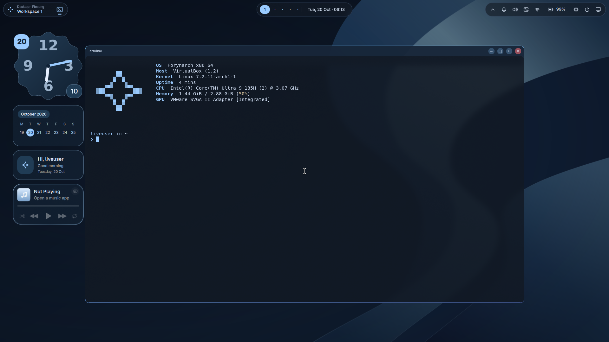

# Forynarch

An Arch-based desktop for productive work, with a calm navy interface.

**Creator:** Muhammad Muzammil Fadhil · **Compositor:** Hyprland · **Status:** active development

Forynarch combines floating and tiling windows, a compact application hotbar,
customizable widgets and a standalone guided installer. The tested installed
core must stay below **3,000,000,000 bytes of idle used RAM**, measured as
`MemTotal - MemAvailable`, with swap reported separately. A Live USB and the
builder VM are separate environments, not installed-target benchmarks.

Full-image candidate: [R5.9.0 release and verification](docs/release-r5.9.0.md).
Public repository preparation: [publishing checklist](docs/publishing.md), [contributing](CONTRIBUTING.md), [security](SECURITY.md) and [credits](CREDITS.md).

[Recent fixes and test evidence](docs/release-r5.9.0.md) include the R5.8.8 native titlebar repaint fix, application exceptions, media integration and installer updates.

## Current scope



[Screenshot gallery and test environment](docs/screenshots/README.md). These
captures show the full ISO in a VM; the displayed memory figure is not an
installed-system idle benchmark.

- Navy/blue Quickshell desktop with restrained motion, optional glass, reduced
  effects, window previews and distinct application/action icons.
- Per-workspace floating/tiling, independent per-window overrides, directional
  focus/swap, half/quadrant arrangements and jointly resizable pairs.
- Settings for Wi-Fi, Bluetooth, audio devices/defaults, displays, power,
  appearance and editable shortcuts with conflict detection.
- Compact background-app tray and a notification center with persistent DND,
  custom focus allowlists, banner controls and session history.
- Widget switches, grid-assisted placement, presets and import/export of
  user-created JSON packs, plus editable local QML sources. Imported widgets start disabled.
- Optional desktop application shortcuts with a searchable selection, disabled by default.
- Live Try/Install Welcome, SDDM Kath login/logout, and a small animated
  Plymouth boot theme with estimated progress.
- Standalone guided setup with account, storage, driver and optional software
  choices. Dedicated-disk and prepared root/EFI installation are implemented.
  Partition preparation uses KDE Partition Manager; automatic resizing and
  encrypted Linux installation are not offered.

Hardware validation is ongoing. An ISO build and passing source tests alone do
not make a hardware-certified release. Review documents record exact checks
and remaining limits.

## Users choose their software

Git, Node.js, npm, pip, Docker, IDEs and developer toolchains are **opt-in** during
installation. Browsers and productivity applications are initial setup choices.
Live Firefox and installer/recovery tools do not become automatic installed
defaults. Python remains a documented transitive runtime dependency of selected
Arch packages; it does not select a developer group.

The installed system uses an independent minimal root filesystem, rather than
copying the Live image wholesale. `packages/development.txt` is a wishlist;
the optional catalog is not a valid Calamares configuration.

## Documentation

Start with the [Markdown wiki](docs/wiki/README.md):

- [Desktop customization](docs/wiki/customization.md)
- [Panel components and battery power](docs/wiki/panel-and-battery.md)
- [Create, import and share widgets](docs/wiki/widget-packs.md)
- [Boot, Welcome and login](docs/wiki/boot-and-login.md)
- [Build, test and measure memory](docs/wiki/build-and-test.md)
- [Credits and licensing details](docs/wiki/credits.md)

Contributors should read the [vision](docs/vision.md),
[architecture](docs/architecture.md), [installer specification](docs/installer-spec.md),
[roadmap](docs/roadmap.md) and [agent agreement](AGENTS.md) before changing scope.

Implementation and evidence: [hybrid windows](docs/hybrid-floating-windows.md),
[hotbar and icons](docs/hotbar-snap-icons-review.md),
[Welcome/logout](docs/live-welcome-login-review.md),
[graphical boot](docs/graphical-boot.md), [installer](docs/standalone-installer.md),
[settings/hotkeys](docs/settings-and-hotkeys.md),
[Windows filesystems](docs/files-and-windows-drives.md),
[optional software](packages/optional-catalog.yaml), and
[runtime dependencies](docs/runtime-dependencies.md).

Built images include the wiki at `/usr/share/doc/forynarch/docs/wiki`.

## Development and builds

Edit source on Windows. Archiso builds run inside an Arch Linux VM on a
Linux-native filesystem. Do not run `mkarchiso` from PowerShell or build on a
Windows shared folder. Generated images, caches, VM disks and keys belong in
ignored output directories. The builder needs librsvg to render the small boot
assets; this does not select developer tools in the installed OS.

See [automation](docs/automation.md), [VirtualBox setup](docs/virtualbox-builder.md)
and [verification](tests/verification-plan.md).

```sh
python -m unittest discover -s tests -p 'test_*.py' -v
python scripts/hotkeys.py --check
git diff --check
```

Run native desktop, Bash, PAM and boot tests in Arch. Pure Python tests can run
on Windows; skipped native tests must not be reported as passed.

## Credits

The MacShell panel option, player components and Liquid Glass shader adapt
[0-ss/MacShell](https://github.com/0-ss/MacShell) by Rickky under its MIT license.
See [source provenance](config/quickshell/forynarch/MACSHELL-SOURCES.md), the
[retained license](licenses/MacShell-MIT.txt), and the
[screenshots, clipboard and music guide](docs/wiki/screenshots-clipboard-and-media.md).

Thank you to the upstream authors and maintainers. This table includes direct
integrations, the inherited theme lineage and the user's design references.
[Detailed provenance](docs/wiki/credits.md) separates bundled code, runtime
packages, inspiration and development-only tools.

| Project | Contribution |
| --- | --- |
| [yeyushengfan258/Particle-circle-grub-theme](https://github.com/yeyushengfan258/Particle-circle-grub-theme) | GRUB window theme; GPL-3.0 license, pinned provenance and font source retained in [boot-theme documentation](docs/grub-particle-circle.md) |
| [Arch Linux](https://archlinux.org/), [Archiso](https://gitlab.archlinux.org/archlinux/archiso), [mkinitcpio](https://gitlab.archlinux.org/archlinux/mkinitcpio/mkinitcpio), [mkinitcpio-archiso](https://gitlab.archlinux.org/archlinux/mkinitcpio/mkinitcpio-archiso) | Base, packages, ISO and initramfs tooling |
| [Hyprland](https://github.com/hyprwm/Hyprland), [Quickshell](https://github.com/quickshell-mirror/quickshell), [Qt](https://code.qt.io/) | Compositor and desktop/UI foundation |
| [Keyitdev/sddm-astronaut-theme](https://github.com/Keyitdev/sddm-astronaut-theme) | Adapted Hyprland Kath theme; GPL-3.0-or-later notices retained |
| [MarianArlt/sddm-sugar-dark](https://github.com/MarianArlt/sddm-sugar-dark) | Original theme lineage credited by Astronaut's source |
| [pctrade/end4-pC](https://github.com/pctrade/end4-pC), [end-4/dots-hyprland](https://github.com/end-4/dots-hyprland) | User-selected visual reference and its upstream lineage; not a wholesale shell import |
| [basecamp/omarchy](https://github.com/basecamp/omarchy) | Hotkey compatibility and web-app workflow inspiration |
| [tabler/tabler-icons](https://github.com/tabler/tabler-icons) | Selected recolored SVGs with retained MIT license/source revision |
| [SDDM](https://github.com/sddm/sddm), [Plymouth](https://gitlab.freedesktop.org/plymouth/plymouth) | Graphical login/session management and early boot engine |
| [Thunar](https://github.com/xfce-mirror/thunar), [KDE Partition Manager](https://invent.kde.org/system/partitionmanager), [UDisks](https://github.com/storaged-project/udisks) | File Manager and storage integration |
| [Waybar](https://github.com/Alexays/Waybar), [swaybg](https://github.com/swaywm/swaybg), [mako](https://github.com/emersion/mako), [foot](https://codeberg.org/dnkl/foot), [fuzzel](https://codeberg.org/dnkl/fuzzel), [Cava](https://github.com/karlstav/cava) | Classic panel/launcher, wallpaper, notifications, terminal and music visualization |
| [systemd](https://github.com/systemd/systemd), [NetworkManager](https://gitlab.freedesktop.org/NetworkManager/NetworkManager), [BlueZ](https://github.com/bluez/bluez), [PipeWire](https://gitlab.freedesktop.org/pipewire/pipewire), [WirePlumber](https://gitlab.freedesktop.org/pipewire/wireplumber) | System, networking, Bluetooth and audio services |
| [Noto Emoji](https://github.com/googlefonts/noto-emoji), [Unicode](https://www.unicode.org/) | Packaged emoji font and licensed emoji catalog data |
| [homarr-labs/dashboard-icons](https://github.com/homarr-labs/dashboard-icons) | Suggested optional web-app icon source; not bundled by default |
| [miqdadbadjuber/anti-slop](https://github.com/miqdadbadjuber/anti-slop) | Development-time interface/writing review guidance |
| [Calamares](https://codeberg.org/Calamares/calamares), [NVIDIA open GPU modules](https://github.com/NVIDIA/open-gpu-kernel-modules) | Installer research and optional driver planning references |

Public builds use Forynarch navy artwork. The optional Kath media follows upstream's MotionBgs lineage and is excluded pending redistribution review. GIPHY attribution applies to optional GIF
search. Web-app icons and trademarks keep their owners' rights. Apple emoji fonts
are not redistributed. See [theme provenance](config/sddm/themes/forynarch-kath/UPSTREAM.md),
[icon sources](assets/icons/Forynarch/SOURCES.md) and [retained licenses](licenses/).

## Licensing status

Public release is being prepared. This repository has no approved top-level LICENSE for
Forynarch-authored code yet. A project-wide license has not been silently assigned.
Third-party licenses are retained; the complete public-distribution licensing
review remains open. The Workday JSON example is separately dedicated under CC0-1.0.

### Terminal and shell

The default terminal is [Alacritty](https://github.com/alacritty/alacritty),
with [Zsh](https://www.zsh.org/),
[zsh-users/zsh-autosuggestions](https://github.com/zsh-users/zsh-autosuggestions)
and [Fastfetch](https://github.com/fastfetch-cli/fastfetch).
[xero/dotfiles](https://github.com/xero/dotfiles) (CC0) inspired the modular shell
configuration and minimal prompt. See the pinned source revisions and retained
licenses in [shell source credits](config/zsh/SOURCES.md).
Foot is retained in historical credits for earlier builds; it is no longer a
default/core package. Git and development toolchains remain opt-in.

Terminal logo rendering uses [Chafa](https://github.com/hpjansson/chafa) and [librsvg](https://gitlab.gnome.org/GNOME/librsvg) at build time; Chafa is not installed in the target. See [panel, sound and time documentation](docs/wiki/panel-audio-and-time.md).

Experimental existing-OS virtualization uses [QEMU](https://www.qemu.org/),
[EDK II / OVMF](https://github.com/tianocore/edk2),
[swtpm](https://github.com/stefanberger/swtpm),
[libtpms](https://github.com/stefanberger/libtpms), Linux KVM/device-mapper,
[mtools](https://www.gnu.org/software/mtools/),
[dosfstools](https://github.com/dosfstools/dosfstools) and
[NTFS-3G](https://github.com/tuxera/ntfs-3g). Their licenses remain with the
upstream projects. These tools are optional; see the
[VM guide](docs/wiki/experimental-virtual-machines.md).
