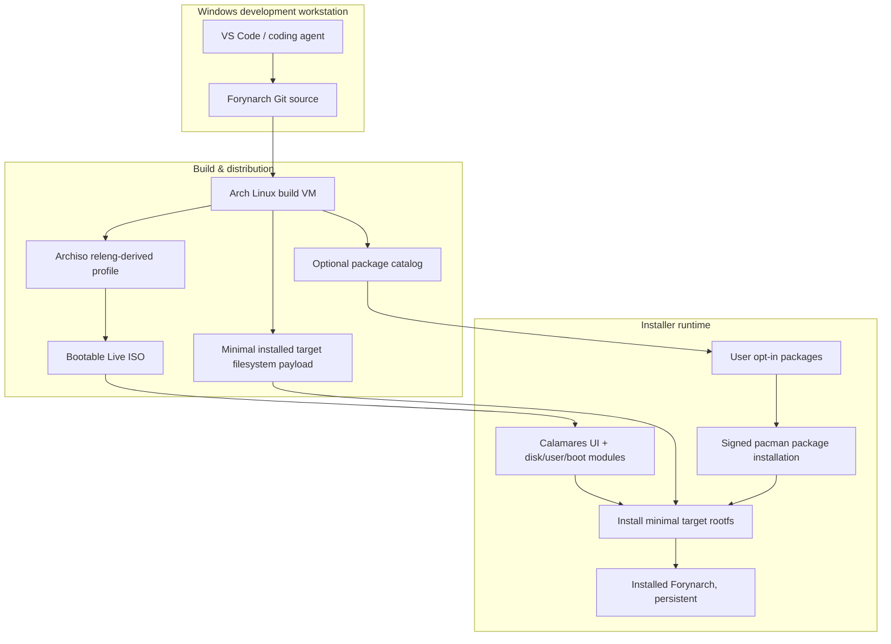
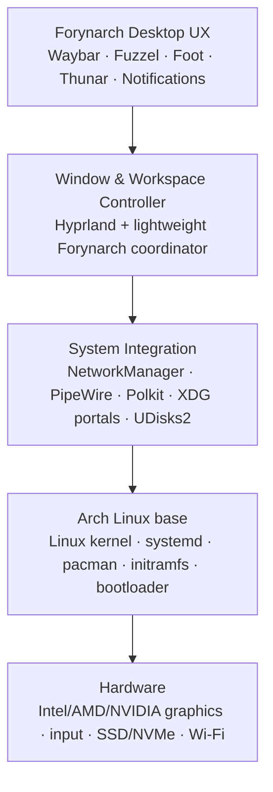
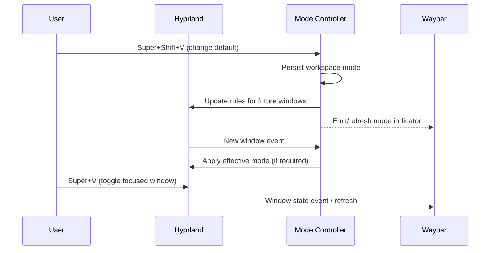
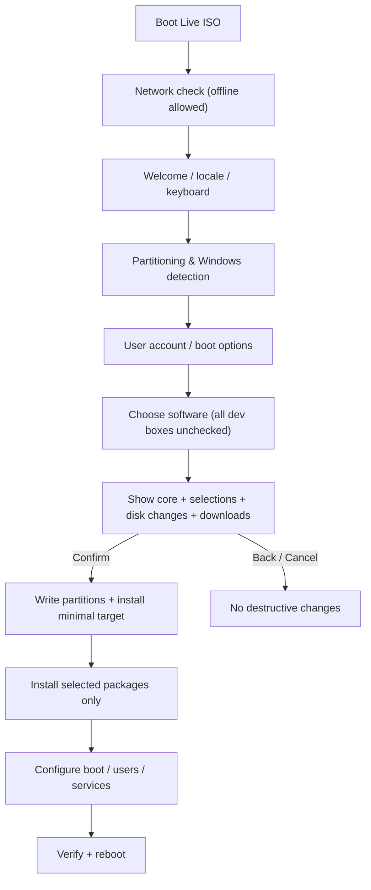

# Forynarch — System Architecture

> **Creator:** Muhammad Muzammil Fadhil · **Project started:** 12 October 2026  
> **Revision:** 15 October 2026 · **Status:** Experimental implementation; selected VM acceptance tests passed  
> **Source document:** [vision.md](vision.md) · **Delivery plan:** [roadmap.md](roadmap.md)

## 1. Goals and boundaries

The standalone installer now executes confirmed dedicated-disk ext4 installs
through a private-stdin privileged helper. Actual offline installation, EFI boot
and login passed in a disposable VM. The installed idle-memory gate passed.
See the [implementation review](production-desktop-review-2026-10-15.md).
The wider architecture below still includes unimplemented manual/alongside
layouts, encryption and physical hardware acceptance.

**User update, 2026-10-14:** idle used RAM must remain below 3 GB decimal
(3,000,000,000 bytes) in the tested installed core. The selected end4-pC
screenshot supplies a visual reference for a navy/blue redesign. Source analysis,
measurement rules and the proposed minimal-shell experiment are in
[end4-reference-analysis.md](end4-reference-analysis.md). Richer shell features
must pass measured memory gates before becoming defaults.

Forynarch is an **Arch Linux-derived distribution** with a distinct, lightweight desktop experience powered by Hyprland. The OS should be comfortable for coding without **forcing a development stack** onto everyone.

| In scope | Out of scope / not promised |
| --- | --- |
| Bootable Archiso Live USB and future installable OS | Building a new Linux kernel or replacing Arch pacman |
| Minimal Hyprland session with Forynarch visual identity | Running all Windows `.exe` applications |
| Hybrid floating/tiling at window + workspace level | Guaranteed low idle RAM/battery on all hardware |
| Monitor-local workspaces, familiar switching | Simultaneously native-booting Windows and Linux |
| Choice-first graphical installer with optional packages | Silently repartitioning existing drives |
| Safe data-drive integrations, power profiles | Bypassing encryption or Windows hibernation protections |

The original Forynarch vision additionally covers smart storage, Windows interoperability, multi-OS switching, power optimization, and distinct navy styling; those are retained here as phased subsystems.

## 2. Four distinct environments (critical design decision)

**Do not conflate the Live ISO with the installed operating system.**

1. **Windows authoring host:** VS Code / coding agent / Git; no native Archiso builds.
2. **Arch Linux build VM:** runs `archiso`, `mkarchiso`, package validation and QEMU boot tests. Repository resides on Linux-native filesystem; do not build directly on NTFS share.
3. **Forynarch Live ISO:** bootable hardware testing, terminal/recovery and Calamares UI. May include utilities that are **not** installed later.
4. **Installed Forynarch target:** an independently defined **minimal** root filesystem, then only user-selected additions, persistent after reboot.



**Important implementation risk:** if Calamares `unpackfs` simply extracts the entire Live ISO root, live-only tools (including Git/Python possibly required by live/installer dependencies) can be copied into the installed system. Preferred approach is an independent **target rootfs payload** extracted by the installer; otherwise implement and test exact package removal/isolation. The choice is decided only after a disposable-VM prototype.

## 3. Repository design (Git source of truth)

```text
forynarch/
├── AGENTS.md                       # Agent constraints, safety, coding rules
├── README.md                       # Local setup + current project status
├── .gitignore                      # Never commit generated ISO/build outputs
├── .gitattributes                  # Enforce LF Linux shell/config files
├── docs/
│   ├── vision.md                   # Full original Forynarch vision
│   ├── architecture.md             # This technical design
│   ├── roadmap.md                  # Milestones and evidence gates
│   └── installer-spec.md           # Installer UX and package acceptance
├── archiso/
│   └── profile/                    # Copy of official releng after preparation
├── config/
│   ├── hypr/                       # Hyprland version-specific source config
│   ├── waybar/                     # Status bar + hybrid indicators
│   ├── foot/                       # Lightweight terminal
│   └── fuzzel/                      # Launcher
├── packages/
│   ├── desktop.txt                 # Review list for essential desktop
│   ├── development.txt             # Legacy wishlist only, NOT default install
│   └── optional-catalog.yaml       # Design catalog, not live Calamares syntax
├── scripts/
│   ├── setup-profile.sh            # Prepare official Archiso profile (Arch VM)
│   └── build-iso.sh                # Build the current Archiso profile (Arch VM)
├── assets/                         # Logos, wallpapers, theme tokens
├── tests/                          # Unit/contract/smoke/hardware procedures
├── work/                           # Generated, ignored by Git
└── out/                            # Generated ISO, ignored by Git
```

### Source-to-image mapping

| Git source | Integration destination | Role |
| --- | --- | --- |
| `config/hypr/` | Live `airootfs/etc/skel/.config/hypr/` and minimal target `/etc/skel/` | Compositor config |
| `config/waybar/` | Equivalent per-user config location | Bar and widgets |
| `config/foot/`, `config/fuzzel/` | Equivalent per-user config location | Terminal / launcher |
| `assets/` | Packaged wallpapers/branding | Look and feel |
| `packages/optional-catalog.yaml` | Converter to Calamares package groups after validation | Install choices |
| `archiso/profile/packages.x86_64` | Archiso Live image manifest | **Live-only package collection**, not target install policy |

Files in `airootfs/etc/skel` are templates for new users; root ownership/permissions and hooks must follow the selected Archiso and installer version.

Current source progress: [package tooling](../packages/README.md) implements a non-executing optional selection preview; target/live review candidates are separate. Foot/Fuzzel/Mako/Waybar prototypes exist, while compositor/session and installer integration await an installed-version check. [Latest baseline](current-baseline.md) records current stable Arch observations; [local results](../tests/latest-results.md) distinguish executed checks from pending VM tests.

Experimental follow-up: [automation.md](automation.md) now describes the source pipeline, installed-example/session adapter and dedicated-disk CLI installer. Runtime gates still require an actual installed release; no generated ISO or installer has passed VM/hardware QA. Calamares and the vision's broader desktop/storage/power features remain open.

## 4. Layered OS architecture



### Minimum **installed** core

- Base userspace, kernel, firmware, bootloader, system services and `pacman` for necessary administration.
- Hyprland compositor, compatible session/login entry point, Waybar, Foot, Fuzzel.
- NetworkManager; PipeWire/WirePlumber; notifications; suitable polkit agent; necessary XDG desktop portals.
- Thunar + UDisks2/GVfs integration; fonts, localization and safe fallback to TTY.
- Appropriate graphics stack/driver packages for supported hardware and graphics detection.

**Never treat `git`, `nodejs`, `npm`, `python`, `docker`, IDEs, SDKs as user-required packages.** Exceptions: dependencies may be installed transitively by essential components; the installer must accurately disclose this rather than claiming zero instances of those runtimes under all conditions.

## 5. Hyprland and hybrid window controller

### Responsibility

- Hyprland owns rendering, workspace management and window floating/tiling state.
- **Forynarch Mode Controller** coordinates preferences and dispatches requested state transitions. Start with minimal configuration + small helper rather than a permanent daemon.
- Waybar observes the active workspace/window and renders `T`, `F`, `M` status; it is **not** the state authority.

### Data model (proposed)

```json
{
  "version": 1,
  "monitors": {
    "monitor-stable-id": {
      "workspace_count": 5,
      "active_slot": 1,
      "workspace_modes": {
        "1": "tiling",
        "2": "floating",
        "3": "tiling",
        "4": "mixed",
        "5": "floating"
      }
    }
  },
  "preferences": {
    "workspace_mode_change_existing_windows": "keep",
    "floating_geometry_restore": true,
    "animation_profile": "balanced"
  }
}
```

Store per-user state in an XDG-compliant path (`~/.config/forynarch/` for user settings, `~/.local/state/forynarch/` for runtime preferences as appropriate). `monitor-stable-id` is a logical identifier derived from supported stable monitor information; **do not blindly use transient names** such as `DP-1` as persistence identity.

### Mode semantics

| Mode | New windows | Existing windows when workspace mode is changed |
| --- | --- | --- |
| `tiling` | Tiled by default | Initially unchanged; explicit "apply to existing" action |
| `floating` | Floating by default | Initially unchanged; explicit bulk conversion |
| `mixed` | Apply validated app rules and last manual override where possible | Never mass-convert implicitly |

A manual per-window `toggle` takes precedence for that existing window, including in a floating-default workspace, until the window closes or the user resets it. New windows use workspace preference and explicit app exception rules.

### Events and control flow



**Implementation:** use the configuration format, API and dispatcher syntax **for the Hyprland version actually installed**, checked against matching official documentation and shipped examples. Do not assume Lua availability or mix configuration formats across releases. Hotkey callbacks must not perform blocking I/O. If a window needs state updated **after** creation, use an event listener/controller; static rules alone cannot reliably react to later changes.

### Multi-monitor mapping

`global_workspace_id = (monitor_index * 5) + local_slot` for index 0, 1, 2 ... and local_slot 1..5. The index is assigned through a stable mapping layer, not the raw connector enumeration order. Shortcut focus and move operate on the **focused monitor**. Handle unplug with a deterministic fallback monitor and preserve user windows. Initial release targets 1–2 monitors; 3+ monitors are later QA expansion.

### Initial shortcut contract

| Shortcut | Operation |
| --- | --- |
| `Super+V` | Toggle focused window float/tile |
| `Super+Shift+V` | Cycle preferred mode for active workspace |
| `Super+1..5` | Select local workspace on focused monitor |
| `Super+Shift+1..5` | Move focused window to a local workspace |
| `Super+Space` | Fuzzel application launcher |
| `Super+Arrow` | Focus the neighboring window without moving it |
| `Super+Shift+Arrow` | Swap the active window with its directional neighbor |
| `Super+Alt+Shift+Tab` | Focus another monitor and explicitly move cursor to it |
| `Alt+Tab` / `Alt+Shift+Tab` | Recent-app/window switcher, forward/reverse |
| `Super+Mouse Drag` | Move floating window |
| `Super+Right Mouse Drag` | Resize floating window |

Avoid conflicts and document how users can override bindings.

## 6. Installer architecture: no forced developer packages

The [standalone frontend](standalone-installer.md) now runs independently of
Settings. Its dedicated configuration and metadata helpers are Live-only;
the installed target rootfs remains independently defined. The frontend has
no privileged executor and does not call the erase-only CLI. Forynarch can
install as the only OS; alongside planning is generic to existing operating
systems. Calamares release/package integration still needs validation.

### Selected approach

- UI candidate: **Calamares** with standard partitioning/user modules.
- Optional software UI candidate: Calamares `netinstall` or `packagechooser` with `packages`; validate module versions and configuration integration before relying on it.
- Package source: official signed Arch repositories. Optional custom repo later, with signed packages and explicit opt-in.
- Minimal target: separate rootfs payload; do **not** assume that removing a few packages from a copied live image is equivalent to a minimal target.

### Installation flow



**Sequence above is the user-facing intent**; actual Calamares `show` and `exec` modules can differ. Disk changes must occur only after the final consent and validation. Installation logs must distinguish skipped, selected, installed and failed operations.

### Package selection model

See [installer-spec.md](installer-spec.md) and [optional-catalog.yaml](../packages/optional-catalog.yaml) for canonical design-level options.

| Category | Example | Default |
| --- | --- | --- |
| Required OS core | Kernel, pacman, Hyprland, Foot, NetworkManager | Required (locked) |
| Developer essentials | Git | **OFF** |
| JavaScript | Node.js and npm (linked selection) | **OFF** |
| Python | Python runtime (pip optionally grouped/documented) | **OFF** |
| Editors | Neovim, Code OSS | **OFF** |
| Containers | Docker / Podman | **OFF** |
| Other SDKs | Go, Rust toolchain, JDK | **OFF** |
| Daily extras | Firefox, multimedia tools | **OFF** unless separately user-approved defaults established |

#### Example resolution

```
selected = ["nodejs-npm", "python"]
resolve(selected) = ["nodejs", "npm", "python"] + necessary pacman dependencies
```

A manifest field `default: false` in the **source catalog** does not magically configure Calamares. An explicit adapter/maintained installer configuration must map this to real module schema, keep defaults unchecked, run validation, and test it. No auto-install of a full `development.txt` wishlist.

### Online/offline mode

- **Online recommended:** fetch only selected optional packages through pacman from signed repositories. Show approximate download requirements before confirmation if resolvable.
- **Offline:** always support minimal core installation from local target filesystem payload; show optional software as unavailable if not bundled. Optional offline bundles increase ISO size and require separate packaging/verification work.
- **Failed network:** do not silently switch to an unexpected package selection; offer retry or safe core-only option before final disk operation.
- **After install:** chosen tools can be installed later through pacman or an opt-in software center; keep no-selection installation useful.

### Disk safety and Windows dual boot

- Enumerate disks, partition UUIDs, existing OS/ESP, BitLocker and NTFS conditions where detectable; **never** guess which volume can be overwritten.
- Show explicit disk/partition, mount point, format changes and risk to existing data.
- Require deliberate confirmation for erase/format and distinguish `install alongside` from `erase disk`.
- No silent alteration of EFI, Windows recovery or NTFS; test Windows Boot Manager preservation on disposable VMs.
- Avoid enabling Secure Boot support as a claim until signing, shim/UKI and real-hardware verification are designed.
- Store installer logs without storing passwords or recovery keys.

### Critical acceptance tests

1. No optional selections → minimal target boots and works.
2. Git selected → Git works; Node/npm not explicitly installed.
3. Node/npm selected → both work; Git not explicitly selected.
4. Python selected → Python works; Git and Node/npm not explicitly selected.
5. Empty selection offline → successful minimal installation.
6. Partitioning cancelled → no disk changes.
7. Live-only installer/build packages not copied to target unless required by package dependencies.
8. Dependencies and size are summarized honestly; package signature checks enabled.

## 7. Storage and interoperability

```text
GUI (Thunar, later Forynarch Drives)
    ↓
UDisks2 + GVfs + Polkit authorization
    ↓
Linux native mount paths /run/media/<user>/<label>
    ↓
Optional aliases /drives/C, /drives/D (UUID-based, never direct disk letters)
```

Policies per drive: manual, ask, trusted automount. No bypass of encrypted volumes. Use NTFS/exFAT for cross-OS sharing, consider Btrfs/ext4 for Linux root. Do not write to Windows volumes that are hibernated or otherwise unsafe. `C:` shortcuts are a shell UX layer, not a claim that Linux universally supports Windows paths.

## 8. Power and thermal subsystem

- Power profiles: Eco, Balanced, Performance.
- Select a single compatible solution (e.g., power-profiles-daemon **or** TLP/tuned according to hardware and policy), never simultaneous conflicting managers.
- Prefer stable driver defaults and hardware-safe tuning over dubious kernel tweaks.
- User-configurable reduced motion, animation throttling and background-service limits.
- Benchmark at a fixed brightness, identical workload, AC/battery conditions and kernel version; keep evidence in `tests/benchmarks/` later.

## 9. Windows app and OS switching (later milestones)

- **Wine/Bottles**: opt-in. Apps integrated in launcher/Hyprland where compatible; no universal Windows-app support promise.
- **Proton**: optional supported gaming pathway.
- **KVM/QEMU**: optional VM option, not a substitute for native hardware support; requires sufficient resources and legitimate Windows licensing.
- **Existing EFI OS VM (experimental):** installer support is opt-in and Settings
  activation is independently off by default. An authenticated supervisor maps
  only the selected OS partition into a private GPT/EFI view. Preview uses a
  disposable overlay; Direct requires fresh consent and clean Windows NTFS.
  QEMU and swtpm run unprivileged under an on-demand systemd unit. No whole-host
  disk is passed through. See [the VM contract](experimental-os-vm.md),
  [user guide](wiki/experimental-virtual-machines.md) and
  [verification report](experimental-os-vm-review.md).
- **Switch OS:** enumerate boot entries, then offer safe reboot-to-entry only if supported by bootloader/firmware. Windows never runs natively alongside the Linux kernel without virtualization.

## 10. Visual design tokens

| Token | Value | Usage |
| --- | --- | --- |
| `deep-blue` | `#425B9A` | Primary interactive accent |
| `sky-blue` | `#76C0EC` | Secondary accent |
| `warm-cream` | `#FFF6DC` | Light foreground / accents |
| `soft-peach` | `#F2B49B` | Sparse highlights |
| `dark-navy` | `#293B5F` | Supporting dark surface |

Dark-first; balanced contrast; restrained round corners; low-opacity effects only when accessibility and performance allow them. Avoid adding multiple toolkits, compositors or overlapping status daemons.

## 11. Test strategy and release gates

| Layer | Technique | Gate |
| --- | --- | --- |
| Static | YAML/JSON validation, shellcheck, docs links, package lists | CI without disk writes |
| Controller | Mocked workspace events, serialization tests | Stable per-window/per-workspace mapping |
| Build | Fresh Arch VM, `mkarchiso`, checksum and manifest | ISO produced reproducibly |
| Boot | QEMU/OVMF disposable VM | UEFI boot + recovery CLI |
| Desktop | Real hardware (GPU, audio, Wi-Fi) | Hyprland stable, login/logout |
| Installer | Disposable VM disk + snapshot comparisons | Default, selective and offline install pass |
| Dual boot | VM with Windows-like EFI partitions first | Never formats unexpected partitions |
| Power | Fixed laptop benchmark procedure | Measured results with hardware notes |

**Definition of done:** a feature is not complete based only on code generation, static design or a screenshot. Record actual test environment and evidence. Record known limitations openly.

## 12. Git workflow and credentials

- `main`: reviewed work; `feat/*`, `fix/*`, `docs/*` branches for changes.
- Protected artifacts: never commit `.iso`, `out/`, `work/`, `*.qcow2`, tokens, SSH private keys, installer passwords, or personal machine paths.
- Tag and publish releases with SHA-256. Git is needed by **contributors/builders**, **not mandatory** for OS end-users.
- CI may lint docs/metadata without privileged execution. Privileged Archiso builds must run only on trusted runners with isolated volumes.
- Link to upstream Arch Linux correctly; never imply official sponsorship. Check the Arch trademark policy before distributing branding.

## 13. Open architecture decisions (ADRs to write)

1. Calamares + minimal target payload creation strategy (highest priority after live ISO).
2. Online-only optional package installation vs offline cache tradeoff.
3. Monitor identity/reassignment and per-window override persistence.
4. Ext4 vs Btrfs by default; snapshot/rollback UX.
5. Exact power profile manager for first hardware matrix.
6. Installer secure-boot strategy and unsupported-system fallback.
7. Repo hosting, signing and release distribution policy.

## 14. Official references and version checks

- [Archiso overview](https://wiki.archlinux.org/title/archiso)
- [Archiso profile reference](https://github.com/archlinux/archiso/blob/master/docs/README.profile.rst)
- [Hyprland key bindings](https://wiki.hypr.land/Configuring/Basics/Binds/)
- [Hyprland window rules](https://wiki.hypr.land/configuring/core/rules/window-rules/)
- [Calamares official documentation](https://calamares.codeberg.page/)
- [Calamares packagechooser configuration](https://codeberg.org/Calamares/calamares/src/branch/calamares/src/modules/packagechooser/packagechooser.conf)
- [Calamares package installation module](https://codeberg.org/Calamares/calamares/src/branch/calamares/src/modules/packages/packages.conf)
- [Arch Linux trademark policy](https://terms.archlinux.org/docs/trademark-policy/)

Recheck the installed versions before implementing exact syntax or distribution claims; the documents above describe a **design**, not proof of feature availability in the current build.
