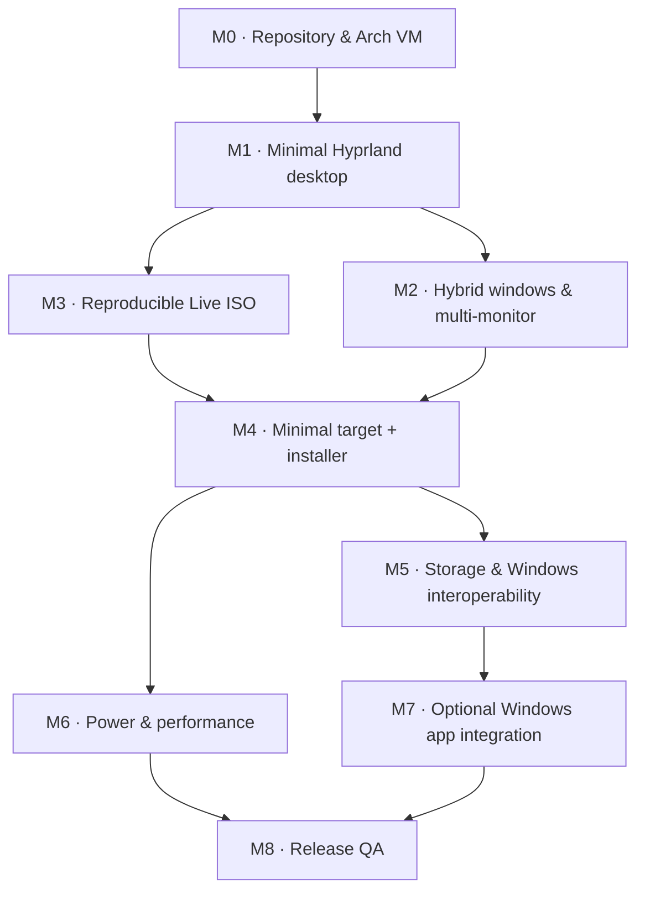

# Forynarch — Development Roadmap

> **Project:** Forynarch · **Creator:** Muhammad Muzammil Fadhil · **Started:** 12 October 2026  
> **Base:** Arch Linux · **Desktop:** Hyprland · **Status:** Architecture & planning, not yet a released distro  
> **Document revision:** 14 October 2026 · **Source of truth for product vision:** [vision.md](vision.md)

## 1. North star

Standalone setup has a separate nine-stage application and an executing,
confirmed dedicated-disk ext4 backend. A real offline VM installation, EFI boot
and authenticated desktop login passed. The installed-core idle RAM gate passed
at 1.2243 GB decimal. See the [current evidence and remaining limits](production-desktop-review-2026-10-15.md).
Manual/alongside layouts, encryption, physical hardware and recovery acceptance
remain pending; the complete product milestone is not closed.

Storage/installer preparation now has a [read-only explorer and review prototype](storage-and-installation-preparation.md).
Partition execution, the complete graphical installer and dual-boot boot tests
remain pending. No milestone is marked complete by this preparation work.

15 October settings prototype: see [implementation and remaining coverage](settings-and-hotkeys.md).
The Glass VM has 13 categories and shared hotkey guides; monitor-local allocation
has fixture tests. This does not complete workspace-default policy, physical
device acceptance, installer milestones or the installed idle-memory matrix.

Build an Arch-based desktop OS that is **lightweight, elegant, comfortable for coding, and practical for everyday use**. The signature features are (a) hybrid tiling/floating per window and per workspace, (b) independent workspaces per monitor, (c) safe, Windows-friendly disk management, and (d) a **choice-first installer**.

**Non-negotiable:** Git, Node.js, npm, Python, Docker, IDEs, and language toolchains are **NOT forced onto the installed system**. They are optional selections in the installer. Build tools may be needed **inside the builder/live environment**, but must not accidentally leak into the minimal installed target.

### Product principles

1. Minimal, not incomplete: the installed core can boot, log in, launch a terminal, connect to network, play audio, open files, and manage system permissions.
2. No forced development stack: no automatic developer-tool selection. Pacman and mandatory OS dependencies are exceptions, not optional applications.
3. Keep the Live ISO, the installed-system rootfs, and optional package choices **separate**.
4. Default to safe disk operations, explicit confirmation, and preserving Windows installations.
5. Prioritize maintainability and native Arch tooling before custom daemons or reinvention.
6. Perf, battery, thermals and size are **targets to measure**, never promised universal results.

## 2. Release definitions

| Release / artifact | What it proves | Not yet promised |
| --- | --- | --- |
| `dev-preview` | Hyprland setup launches on compatible hardware, interaction prototypes work | Installable OS or stable ISO |
| `v0.1.0-alpha-live` | Archiso build boots into a usable Live desktop with a fallback | Finished installer, safe dual-boot |
| `v0.2.0-alpha-install` | End-to-end installation to disposable test disk, minimal target OS boots | Production safety across all hardware |
| `v0.3.0-beta` | Opt-in packages, hardware tests, recovery and installer safety tests pass | Universal Windows software compatibility |
| `v1.0` (future) | Documented, reproducible, maintainable release supported by real-device QA | Any particular battery-life improvement guarantee |

Version labels are planning targets, **not release claims or deadlines**.

## 3. Dependency map

## 4. Milestones, tasks & exit criteria

### M0 · Foundation, Git and build isolation (P0)

- [ ] Name and creator metadata set everywhere to `Forynarch` / `Muhammad Muzammil Fadhil`.
- [ ] Track source in Git. Add `.gitignore` and `.gitattributes` (`LF` for Linux scripts).
- [ ] Establish `main`, feature branches `feat/<topic>`, and reviewable commits; no secrets or ISO images in Git.
- [ ] Prepare Arch Linux x86_64 VM on Windows; build on its Linux filesystem, not NTFS shared folder.
- [ ] Verify installed `archiso`, target Arch and Hyprland versions; record build metadata.
- [ ] Copy upstream Archiso `releng` profile with `scripts/setup-profile.sh`; review upstream changes.
- [ ] Decide license(s), attribution rules and branding/trademark review before public launch.

**Exit:** starter repo opens in a coding agent, `AGENTS.md` is read, Git shows only expected source files, Arch VM has a functional build toolchain. No user disk partition modified.

### M1 · Usable minimal desktop (P0)

- [ ] Choose the configuration format supported by the installed, recorded Hyprland release and its matching official documentation; do not assume Lua availability or mix syntax across releases.
- [ ] Configure Hyprland + Waybar + Foot + Fuzzel + Thunar, notifications, polkit, XDG portals, clipboard, screenshot, lock/logout.
- [ ] Wire NetworkManager, PipeWire/WirePlumber, fonts, brightness, sleep/resume and sensible login/session startup.
- [ ] Apply Forynarch design tokens: `#425B9A`, `#76C0EC`, `#FFF6DC`, `#F2B49B`, `#293B5F`.
- [ ] Create dark-first, navy identity; validate accessibility and support reduced motion/low-power visuals.
- [ ] Ensure system works without installing Git/Node/Python as explicit *user* tooling.

**Exit:** a user can log in, navigate, open files, configure Wi-Fi, hear audio, and use the terminal on supported graphics hardware. Record screenshots and defects, do not claim battery gains.

### M2 · Hybrid window and workspace UX (P0)

- [ ] `Super + V`: toggle floating/tiling **only** on focused window.
- [ ] `Super + Shift + V`: change **workspace default**, with clear policy for existing windows (initially: ask or keep current states; explicit bulk conversion later).
- [ ] Persist modes `tiling`, `floating`, `mixed` by monitor/workspace; allow per-window override without altering workspace preference.
- [ ] Waybar shows subtle `T`, `F` or `M` mode; support efficient Win-like `Alt+Tab` recency behavior.
- [ ] Monitor-local `Super + 1..5` and `Super + Shift + 1..5` move/focus behavior. Monitor 1 ↔ IDs 1–5; monitor 2 ↔ 6–10, etc. Visible labels stay 1–5.
- [x] Apply the 15 October shortcut clarification: `Super + Arrow` focuses windows; `Super + Shift + Arrow` swaps directional neighbors. `Super + Alt + Shift + Tab` still focuses another monitor and moves the cursor explicitly.
- [ ] Handle monitor hotplug, migration of orphaned windows, remembered active workspace, reasonable floating geometry across scales.
- [ ] Keep hotkey actions non-blocking; write focused tests for mode state transitions and mapping.

**Exit:** window override, per-workspace defaults, indicator and 2-monitor workspace mapping work in repeatable tests; reboot restores preferences. Disconnecting a monitor does not lose windows.

### M3 · Buildable live ISO (P0)

- [ ] Make archiso `releng` profile a tracked **reviewed** upstream-derived source.
- [ ] Add required live-only packages: installer, diagnostics, connectivity and recovery tools (may differ from installed target).
- [ ] Integrate desktop config in `airootfs` and ensure executable permissions via `profiledef.sh`.
- [ ] Generate ISO from a clean Arch VM; log versions, selected upstream template and ISO checksum.
- [ ] Smoke-test UEFI boot with QEMU (not equivalent to Hyprland GPU test), plus supported real hardware for graphical test.
- [ ] Provide a safe text-console fallback when Wayland graphics fail.

**Exit:** reproducible ISO exists and boots; `checksums.sha256` and a build record are generated. **Live ISO does not automatically mean installable distro.**

### M4 · Installer, minimal target rootfs, voluntary packages (P0)

- [ ] Integrate **Calamares** as the preferred graphical installer candidate (subject to version, profile and module integration tests).
- [ ] Explicitly separate `Live environment` (can contain build/installer dependencies) from **installed target rootfs** (minimal and independently defined).
- [ ] Prototype target-rootfs creation and install method: separate minimal filesystem payload + Calamares `unpackfs`, or validated package-based bootstrap. Do not blindly clone live filesystem.
- [ ] Add software selection screen using Calamares `netinstall` / `packagechooser` and `packages` module, or a small validated custom selection bridge.
- [ ] All developer selections **unchecked** by default: Git; Node.js + npm; Python; editors/IDEs; Rust; Go; containers, etc.
- [ ] Require positive action for optional packages and show full summary + estimated network needs before disk write.
- [ ] Online mode: selected packages fetched from signed Arch repos; offline mode: install core only unless locally bundled optional packages are clearly available.
- [ ] Never silently download unselected packages; communicate unavoidable transitive dependencies honestly.
- [ ] Ensure target without selections boots and works; verify explicit `git`, `nodejs`, `npm`, `python` are absent **unless pulled by necessary dependencies**, and document such cases.
- [ ] Test EFI creation/reuse; preserve Windows boot manager; offer manual partitioning with double confirmation of destructive operations.
- [ ] Implement account, password, locale, timezone, bootloader, encryption choices, install logs and recovery path.

**Exit:** installs on disposable VM disk in 3 scenarios: nothing selected, Git-only selected, Node/npm + Python selected; the selected/installed package set matches expectations and reboot reaches desktop. Cancel leaves untouched disks unchanged. No actual Windows partition testing until VM criteria pass.

### M5 · Drive experience & dual-boot ergonomics (P1)

- [ ] Drive enumeration via UDisks2/udisksctl and file-manager integration with stable UUID-based IDs.
- [ ] Friendly `C:`, `D:` aliases only as **presentation and opt-in shell shortcuts**; actual mounts remain native paths.
- [ ] Per-device policies: manual / prompt / trusted automount; safe eject; prevent unsafe Windows-NTFS write if hibernated/unclean.
- [ ] Explore shared NTFS/exFAT partition workflow, clearly explaining limitations.
- [ ] Detect boot entries and add *reboot to another OS* where firmware/bootloader allows it.

**Exit:** external drive can be discovered, mounted and ejected safely; protected EFI/recovery partitions not auto-mounted read-write.

### M6 · Battery, thermal and performance (P1)

- [ ] Meet the user's idle used-RAM limit below 3 GB decimal in the installed
  core across three controlled cold boots; record swap and regression after
  opening/closing settings. Compare the blue end4-inspired shell prototype
  against the existing minimal desktop before selecting it as default.

- [ ] Implement Eco / Balanced / Performance profiles with **one** chosen power policy manager, never conflicting services.
- [ ] Evaluate suspend/resume, brightness and CPU idle behavior; add low-power reduced-motion path.
- [ ] Benchmark cold boot, idle RAM/CPU, battery discharge, thermals and development workflow using controlled hardware.
- [ ] Document hardware variations and regressions instead of promising exact RAM or longer battery life.

**Exit:** comparable before/after benchmark sheet across at least one tested laptop; no harmful regression from power policy.

### M7 · Optional Windows app and virtualization integration (P2)

- [ ] Optional Wine/Bottles/Proton integrations (not part of minimal default install).
- [ ] Optional KVM/QEMU Windows VM pathway, with explicit resource and licensing warnings.
- [x] Experimental existing-OS VM implementation: unchecked installer group,
  Settings toggle, partition isolation, Preview/Direct consent and supervised
  cleanup; disposable block, EFI, GTK/Wayland and audio-client tests pass.
- [ ] Existing Windows/KVM hardware acceptance: drivers, activation, BitLocker,
  native boot afterwards, 4Kn and resource/battery measurements. The broader VM
  pathway above remains open until this acceptance is complete.
- [ ] Test application-specific compatibility; avoid universal `.exe` promises.

**Exit:** tested compatibility list and documented failure modes; no Windows VM forced.

### M8 · Security, release validation and publish (P0 for release)

- [ ] Check source licenses, correct attribution, Arch trademark policy and original branding.
- [ ] Test clean installs, reinstall, cancel, offline install, dual-boot simulation, broken network, disk full, secure boot expectations and recovery.
- [ ] Verify package reproducibility within a pinned snapshot/recorded mirror window; signed package verification.
- [ ] Capture hardware matrix (Intel/AMD GPU, NVIDIA caveats, Wi-Fi, touchpad, suspend); known issues.
- [ ] Generate SHA-256, release notes, SBOM/package manifest, screenshots and installation guide.
- [ ] Tag Git release only after QA passes; maintain changelog and security update policy.

**Exit:** public builds clearly labeled alpha/beta/stable, with instructions and no false installability claims.

## 5. P0 sprint order for the coding agent

| Sprint | Deliverable | Minimum demonstration |
| --- | --- | --- |
| 0 | Validated repo, docs, Git baseline | All source tracked; no generated ISO committed |
| 1 | Hyprland minimal desktop | Login → Foot → Waybar → Fuzzel → Thunar |
| 2 | Hybrid prototype | `Super+V` toggle, workspace preference persists |
| 3 | Live ISO pipeline | UEFI boot in QEMU with CLI fallback |
| 4 | Minimal target rootfs design | Documented difference between live and installed packages |
| 5 | Installer options prototype | Empty selections install only core in disposable VM |
| 6 | Installer validation | Git-only and Node/Python cases pass |

**Rule:** no sprint is complete merely because an AI wrote code. Require executed evidence from the correct environment.

## 6. Package policy / acceptance tests

- `CORE_REQUIRED`: kernel, firmware, bootloader, base OS, pacman, Hyprland session and essential daily desktop services. Visible in UI as **Required**, cannot uncheck without breaking the OS.
- `OPTIONAL_DESKTOP`: browser, additional fonts, multimedia, extra utilities.
- `OPTIONAL_DEVELOPER`: Git, Node/npm, Python, IDE/editor, Docker/Podman, Rust, Go, JDK, etc. **Default = not selected**.
- `LIVE_ONLY`: Calamares, recovery/build helpers, tools used only by the installer. **Not assumed installed onto target.**

Acceptance scenarios:

1. Install with **no optional choices** → Hyprland and network usable, no deliberate developer tool preload.
2. Select **Git** → `git --version` works; Node/npm and Python are not explicitly selected.
3. Select **Node.js + npm** → both executable and correct package set installed; Git not silently selected.
4. Select **Python** → runtime works; Node/npm and Git not silently selected.
5. No internet → clear notice; only core/offline-cache available; no hidden failed download chain.
6. User clicks Cancel at disk summary → **no partitions touched**.
7. Run every test with a fresh VM disk; installer must not mutate Windows host disks.

**Note:** pacman dependency resolution can introduce a runtime package indirectly even when not chosen as a development toolkit. Test and explain actual package sets; do not falsely claim impossible universal absence.

## 7. Git conventions

- `main`: reviewed state; feature work in `feat/installer-optional-packages`, `feat/hybrid-workspaces`, etc.
- Commit examples: `docs: define Forynarch architecture`, `feat(installer): add optional developer groups`, `test: cover empty package selection`.
- Never commit `.iso`, `work/`, `out/`, build caches, signing keys or host secrets.
- Use Git for **development of Forynarch**, but **Git itself remains optional for Forynarch users**.

## 8. Decisions still open

- Installer target-rootfs extraction/bootloader strategy once tested against the selected Calamares release.
- Whether offline optional package bundles are worth a larger ISO.
- First-party settings app for modes and drives: GUI in v0.3 or later.
- Kernel channel (`linux` initially; other kernels as optional after compatibility testing).
- GPU support matrix and real laptop battery baseline.
- Public release branding/legal review for the name and logo.

## 9. Source references for implementation

- Archiso Wiki: https://wiki.archlinux.org/title/archiso
- Official Archiso profile: https://github.com/archlinux/archiso/blob/master/docs/README.profile.rst
- Hyprland configuration: https://wiki.hypr.land/Configuring/Basics/Binds/
- Calamares modules: https://codeberg.org/Calamares/calamares/src/branch/calamares/src/modules
- Arch trademark policy: https://terms.archlinux.org/docs/trademark-policy/
